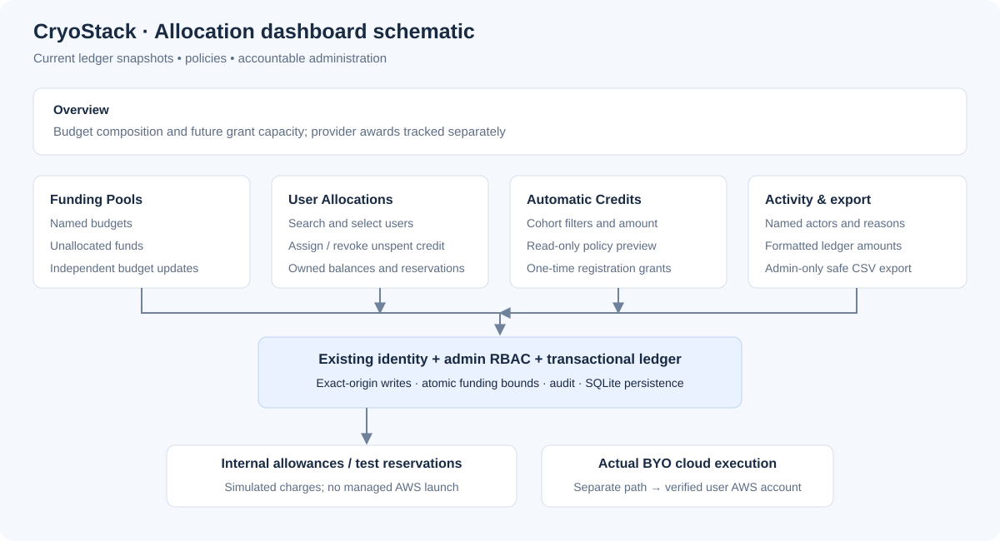

# Allocation dashboard architecture



## Information layout

Diagram source (Mermaid):

```text
flowchart TB
    Shell[Existing Control Center shell] --> Snapshot[Budget / assigned credits / reservations / unallocated funds]
    Snapshot --> Overview[Overview]
    Snapshot --> Pools[Funding Pools]
    Snapshot --> Users[User Allocations]
    Snapshot --> Policy[Automatic Credits]
    Snapshot --> Activity[Activity]
    Snapshot --> Tests[Test reservations]
    Overview --> Composition[Per-pool budget composition]
    Overview --> Capacity[Future registration grant capacity]
    Users --> Search[Admin-only user search]
    Users --> Export[Admin-only balance CSV]
    Policy --> Preview[Saved-policy preview without grants]
```

## Deployed dashboard capabilities

The Overview tab separates each pool's budget into unallocated funds, available
user credit, active reservations, and simulated charges. The composition is a
current snapshot, not an invented historical usage chart or AWS billing feed.
The four segments sum to the pool budget. Labels and numeric values accompany
colors for accessibility.

The funding-readiness panel reports how many future registration grants the
unallocated pool budget can support at the configured amount. Zero-credit
policies show no numerical capacity. An enabled exhausted pool explicitly warns
that another grant cannot be funded. Readiness does not imply provider funding.

Saved-policy preview reports how many existing accounts match the current
filters and the capacity for future registrations. It is a read-only operation;
no introductory grants are issued and existing users remain ineligible for
retroactive awards. It previews saved settings, not unsubmitted form changes.

The CSV export contains the current balance snapshot, names, emails, pool,
allocated, reserved, simulated-charge and available USD amounts. It is restricted
to owner/admin sessions, is not cached, and guards text cells against spreadsheet
formula injection. It is neither provider invoicing nor a full audit export.

## Trust and data flow

Diagram source (Mermaid):

```text
sequenceDiagram
    actor Admin
    participant UI as Dashboard
    participant RBAC as Existing authentication and roles
    participant API as Allocation API
    participant Ledger as Allocation service
    participant DB as SQLite ledger
    Admin->>UI: Edit budget or onboarding policy
    UI->>RBAC: Session-authenticated request
    RBAC->>API: Authorized owner/admin
    API->>API: Exact-origin and JSON checks
    API->>Ledger: Validated mutation
    Ledger->>DB: Begin immediate transaction
    Ledger->>DB: Enforce funding bounds and write audit
    DB-->>Ledger: Commit
    Ledger-->>UI: Saved result
    UI->>API: Refresh current snapshot
```

Budget and policy endpoints update their own fields inside transactions. They
must not save a stale copy of each other's configuration. All writes keep
existing anti-CSRF, role, ownership and live-execution-denial behavior.

## Future provider-funded execution gate

Diagram source (Mermaid):

```text
flowchart LR
    Award[Confirmed provider award] --> Account[Approved institutional billing account]
    Account --> Coverage[Credit coverage and expiry checks]
    Coverage --> Estimate[Reviewed resource estimates and limits]
    Estimate --> Reserve[Atomic funding reservation]
    Reserve --> Authorize[Explicit managed-execution authorization]
    Authorize --> Submit[Account-scoped executor]
    Submit --> Reconcile[Provider billing reconciliation]
    Reconcile --> Finalize[Ledger settlement and audit]
```

This last flow is a future design, not implemented functionality. Receiving an
award or creating an internal pool must not switch on paid workloads. BYO
execution stays a separate user-owned-account path. Google/Azure support needs
provider adapters; ACCESS requires scheduler/resource integration and its own
units, not a conversion to AWS dollars.

## Development priorities

1. Continue validating the deployed snapshot overview, policy previews and export with real
   authenticated browser sessions, including narrow widths and keyboard access.
2. Introduce server-side pagination for activity and balance views before large
   cohorts; keep user search bounded and avoid loading a full directory.
3. Add reviewed pool lifecycle/expiry controls and optimistic versions before
   multi-administrator workflows need explicit stale-edit detection.
4. Track verified provider award references, credit expiry, service exclusions
   and billing reconciliation independently of internal allowances.
5. Build paid managed execution only after funding, accounting and executor
   isolation have separately passed review and received explicit authorization.

No release should publish fabricated activity, forecasted AWS costs as actual
charges, or unawarded provider credits as usable funding.
