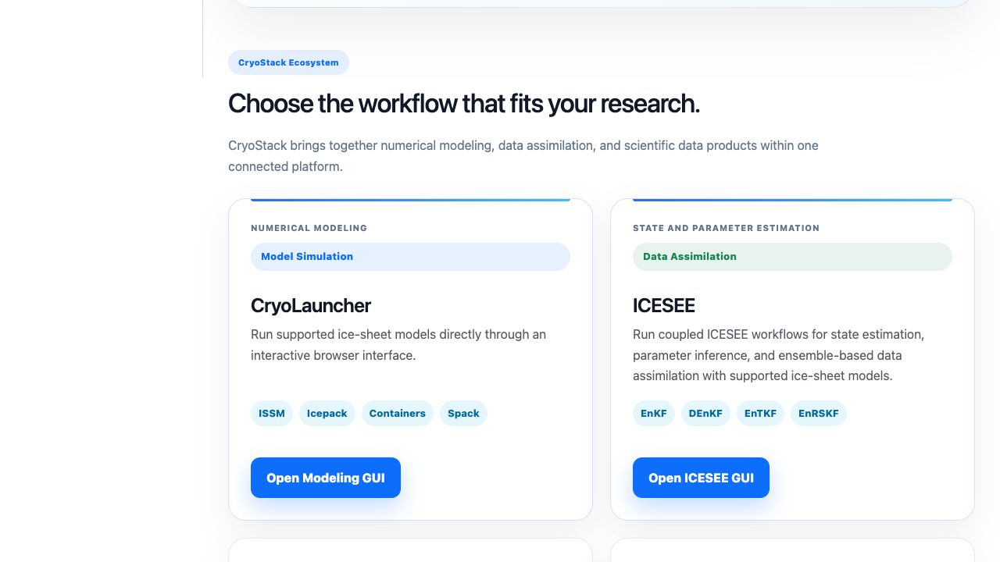
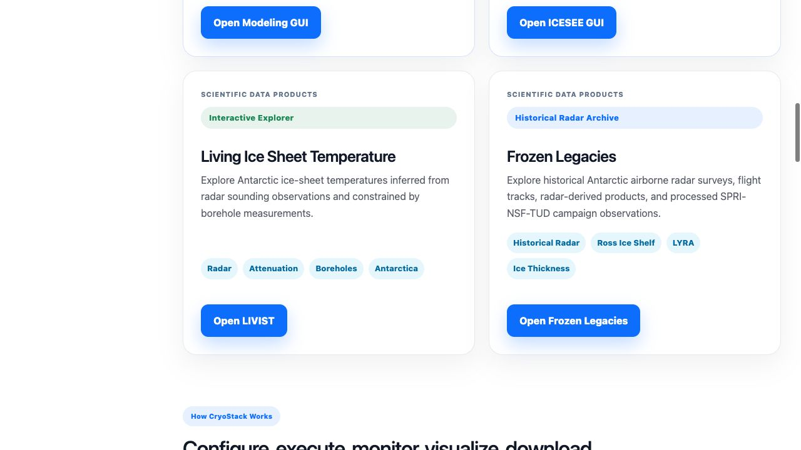
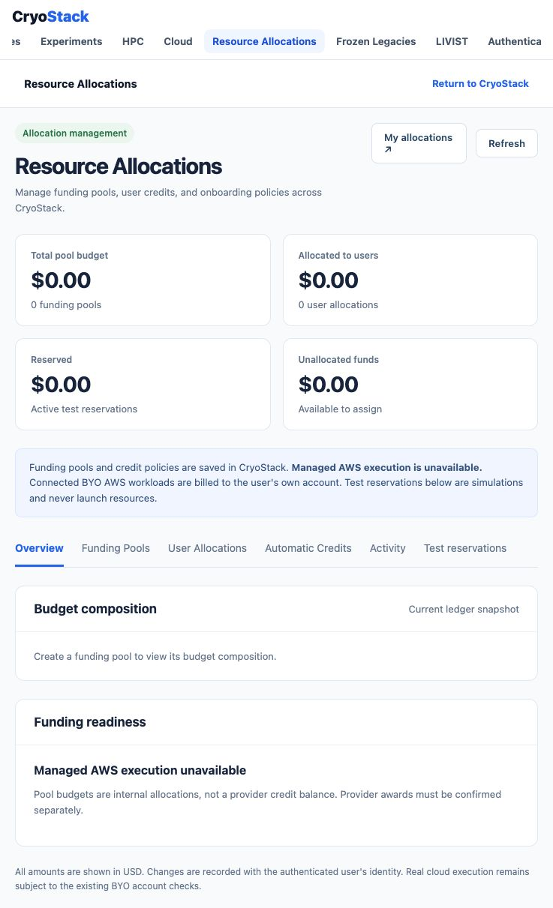
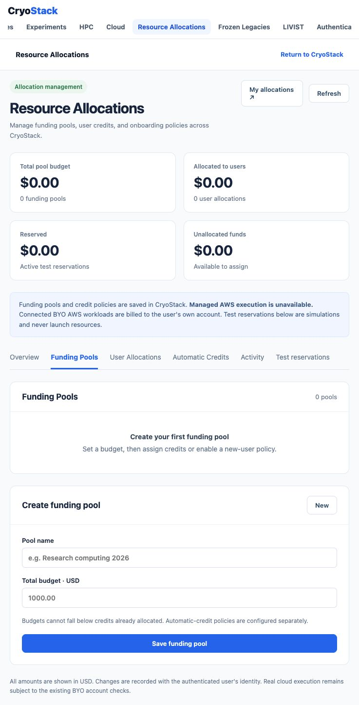
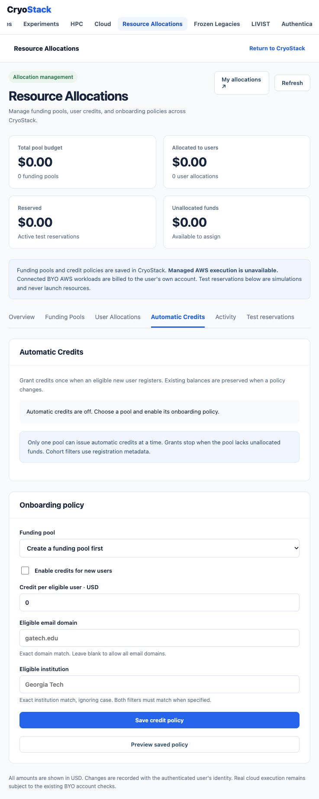
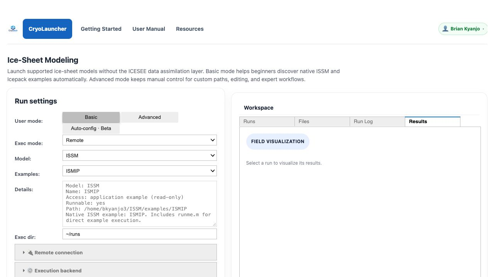

# CryoStack visual walkthrough

These screenshots were captured from the running CryoStack platform on **October 14, 2026**. They show actual interfaces and empty states, not fabricated jobs or funding awards. Controls depend on your role and the current release.

## Choose an application

Open [CryoStack](https://cryostack.eas.gatech.edu/) and sign in using your existing account. Choose CryoLauncher for model execution or ICESEE for data assimilation.

The data applications are LIVIST for ice-sheet temperature exploration and Frozen Legacies for radar data exploration.

## Manage resource allocations

An owner or administrator opens **Control Center → COMPUTE → Resource Allocations**. Ordinary researchers use **My allocations** to inspect their own balances.

This captured account had no funding pools or allocations. Zero values are the real state, not an error. The overview separates unallocated budget, available user credit, reservations, and simulated charges. Internal pool budgets do not establish that a cloud provider has awarded credits.

1. Open **Funding Pools**, create a named pool, and set its internal budget.
2. Open **User Allocations**, search for an existing user, choose the pool, and record an adjustment with a reason.
3. Open **Automatic Credits** to configure an amount and optional cohort filters. Review the saved-policy preview before enabling new-user grants.
4. Inspect **Activity** and export balances when reconciling the ledger.

Saved policies apply to qualifying future registrations, not existing accounts. Test reservations simulate ledger operations; they do not launch AWS resources. Actual BYO jobs require a verified user AWS connection and are billed to that user's account. Managed AWS execution remains unavailable.

See [Resource Allocations](resource_allocations.md) for eligibility, limits, security, and recovery guidance.

## Inspect CryoLauncher results

In CryoLauncher, select the supported model and example, review the execution mode, and configure the required connection. Review the run plan before submitting a scientific workload.

After a run, select it in the workspace and open **Results**. The image below intentionally shows the real empty Results panel before selecting a run; it is not evidence of a completed experiment.

CryoLauncher exposes Remote and Cloud execution. ICESEE has its own Local, Remote, and Cloud workflow; do not assume the same mode controls or model availability across both applications. Follow the model support labels in the running interface. See [Applications](user_apps.md) and [Results](user_results.md).

## Keep screenshots accurate

Capture a new image when labels, navigation, permissions, or important behavior change. Use the live platform and record the date, page URL, role, and state in the change description. Never create jobs, grants, or cloud spending merely to make a screenshot look populated.

Before publishing, inspect the image for credentials, account IDs, private runs, research data, user lists, and saved picks. Prefer an empty workspace or public dataset. Restore temporary display settings after capture. Keep descriptive alt text and a caption explaining empty states. Verify image links in the built book with notebook execution disabled.

ICESEE and Frozen Legacies screenshots are not included here yet: the available captures did not pass loading or privacy review. Their existing manuals remain the source for those workflows.
